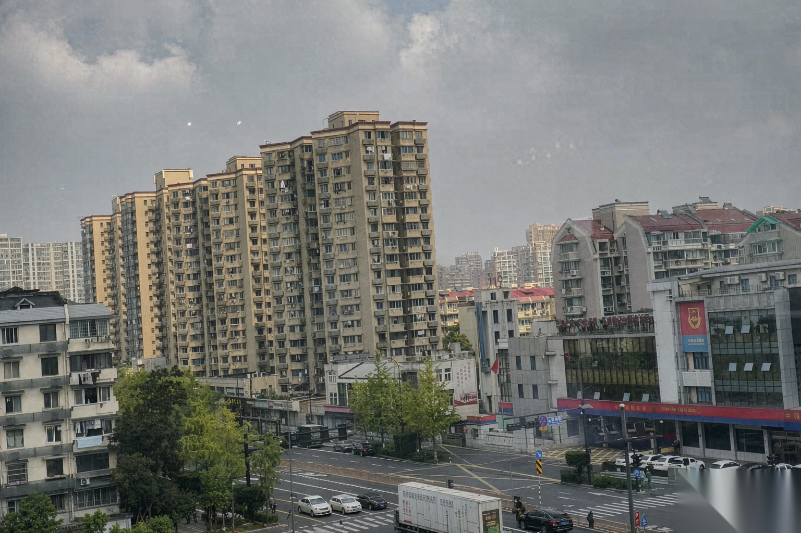

# 城市街景 · DSLR 优化

---

## 基本信息

- **日期**：2026-10-11
- **类型**：图生图 · 照片质感升级（去灰霾 + 保真优化）
- **底图**：微信来图（城市街景：米黄高层住宅 + 十字路口 + 红顶别墅，横构图，原片灰蒙发雾）
- **使用提示词**：[[提示词/照片超写实8K-DSLR级优化提示词-20261010.md]]

---

## 参数记录

| 项 | 值 |
|:--|:--|
| 模式 | ImageGen 图生图 |
| input_fidelity | high |
| 尺寸 | 1536×1024（沿用原图横比例） |
| quality | high |
| style | hyper-realistic DSLR photography, overcast urban scene |
| 附加指令 | 场景锚定（主体=中部住宅楼群）＋ **去灰霾专项指令**（远楼浅灰蓝/近楼饱和正常的大气透视逻辑）＋ 白平衡锁定（不偏黄不偏蓝）＋ 天空云层不过度加深 |
| 后处理 | remove-watermark（telea，region 0.85,0.89,0.15,0.11）抹除右下角"AI生成"水印 |

---

## 效果评估

- ✅ 灰霾感明显去除，云层出现真实层次，天际线恢复大气透视
- ✅ 楼体瓷砖/涂料肌理、路口斑马线、车流轮廓清晰
- ✅ 白平衡准确，阴天柔和光氛围保留，无假 HDR 味
- ✅ 构图与原始场景结构完全一致
- ⚠️ ImageGen（Hunyuan 通道）会自动在右下角加"AI生成"水印——**提示词里要求去水印对模型自带水印无效**，必须后处理。本次用 remove-watermark 传统法一次成功。

## 实战结论（回写母提示词配方）

1. 灰霾底片配方 = 母提示词 + 去灰霾专项（正面描述大气透视逻辑）+ 白平衡锁定 + 云层保护，效果显著。
2. **模型自动水印去不掉**，出图后固定走一遍 remove-watermark（右下角固定位置，region 0.85,0.89,0.15,0.11 对 1536×1024 通用）。

---

## 相关

- [[提示词/照片超写实8K-DSLR级优化提示词-20261010.md]] — 使用的母提示词
- [[产出/图片/古建秋色-超写实8K优化-20261010.md]] — 同配方首战（风光/古建题材）

---
